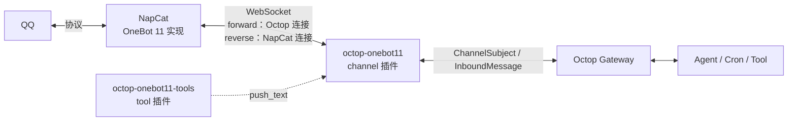

<div align="center">

# Octop OneBot 11

**把个人 QQ 接入 Octop 的 OneBot 11 / NapCat 通道插件**

正向 / 反向 WebSocket · 群聊触发门控 · 主动发送 · 单文件、无额外依赖

[](https://github.com/EchoAI-01/octop-onebot11/releases)
[](https://www.python.org/)
[](LICENSE)
[](https://github.com/TencentCloud/Octop)

[功能](#功能) · [安装](#安装) · [配置](#配置) · [NapCat 配置](docs/napcat.md) · [设计](docs/design.md) · [常见问题](#常见问题)

</div>

---

Octop 官方的 QQ 通道依赖 QQ 开放平台机器人（AppID + Token），无法使用个人 QQ。本插件通过 Octop 的 `kind: channel` 扩展点接入 **OneBot 11** 协议，让 Octop 可以收发个人 QQ 消息，支持 [NapCat](https://github.com/NapNeko/NapCatQQ) 以及任何兼容 OneBot 11 的实现。

截至 2026-10，GitHub 上未检索到其他公开的 Octop OneBot 11 通道实现，因此本仓库同时承担“可用插件”和“接入参考”两个角色。

## 功能

- **两种传输方向**：`forward`（Octop 主动连 NapCat）与 `reverse`（NapCat 主动连 Octop），共用同一套协议与路由代码。
- **群聊触发门控**：默认只响应 `@` 或关键词，非触发消息只进群上下文缓存，不调用 LLM，避免“一直监听 = 一直烧 Token”。
- **私聊策略**：`always` / `keyword` / `off` 三档。
- **主动发送**：附带 `onebot11_send_group` / `onebot11_send_private` 工具，可向任意群/用户发消息，不要求该会话已存在。
- **定时任务零 Token**：配合 Octop cron 的 `task_type=text`，直接走通道发送，不启动 Agent。
- **富媒体发送**：图片、视频、语音、HTTP 文件，单文件上限 10 MB。
- **弱依赖启动**：NapCat 未启动、QQ 未登录时通道照常注册，状态降级并持续重连，不阻塞 Octop 启动。
- **单文件实现**：仅依赖 Octop 自带的 `websockets`，不需要改动 Octop 核心或数据库。

## 架构



- `forward`：NapCat 监听 `0.0.0.0:3001`，Octop 作为客户端接入。
- `reverse`：Octop 监听 `0.0.0.0:3002`，NapCat 作为客户端接入，适合 NapCat 位于 NAT 后或不允许入站的场景。
- 两种模式使用同一条 WebSocket 完成收事件与发 action，通过 `echo` 关联请求与响应。

## 安装

### 前置条件

| 依赖 | 版本 | 说明 |
|---|---|---|
| Octop | 支持 `kind: channel` 插件的版本 | 本插件在 Octop 5.8.x 上验证 |
| Python | 3.12+ | 跟随 Octop 运行时，无需单独安装 |
| websockets | 13+ | Octop 已内置，验证版本 15.0.1 |
| NapCat | 任意较新版本 | 或其他 OneBot 11 实现 |

### 从源码安装

```bash
git clone https://github.com/EchoAI-01/octop-onebot11.git
cd octop-onebot11

# 通道插件
octop plugin install ./plugins/octop-onebot11 --force

# 可选：主动发送工具（Agent 需要主动发消息时安装）
octop plugin install ./plugins/octop-onebot11-tools --force
```

### Docker 部署

Octop 容器内看到的路径与宿主机不同，先把插件目录放到数据目录，再在容器内安装：

```bash
# 宿主机：把插件复制到 Octop 数据目录（示例路径，按实际调整）
scp -r plugins/octop-onebot11 plugins/octop-onebot11-tools \
  user@host:/opt/octop/data/uploads/

# 容器内安装
docker exec octop octop plugin install /data/.octop/uploads/octop-onebot11 --force
docker exec octop octop plugin install /data/.octop/uploads/octop-onebot11-tools --force
docker restart octop
```

> `octop plugin install` 是离线操作：安装后需要重启 Octop，运行中的 Gateway 才会加载新插件。`octop plugin list` 在新进程里显示 `[not loaded]` 属正常现象，以启动日志中的 `applied N plugin channel kind(s)` 为准。

### 验证安装

```bash
octop plugin list
docker logs --tail 100 octop | grep -i "plugin channel kind"
```

## 配置

通道配置既可以在 Octop Dashboard 的表单里填写，也可以用 CLI 一次写入。所有字段都保存在该通道的 `config_json` 中，互不影响，因此同一个 Octop 可以同时运行多个 QQ 通道。

### 正向（Octop 连接 NapCat）

```bash
octop channel create --agent <agent_id> --kind onebot11 --name "QQ (NapCat)" \
  --config '{
    "connection_mode": "forward",
    "ws_url": "ws://127.0.0.1:3001",
    "token": "change-me",
    "group_reply_mode": "mention",
    "trigger_keywords": "小助手,日报,提醒"
  }'
```

### 反向（NapCat 连接 Octop）

```bash
octop channel create --agent <agent_id> --kind onebot11 --name "QQ (NapCat 反向)" \
  --config '{
    "connection_mode": "reverse",
    "listen_host": "0.0.0.0",
    "listen_port": 3002,
    "listen_path": "/onebot/v11/ws",
    "token": "change-me"
  }'
```

创建后执行 `octop restart`（或 `docker restart octop`）让 Gateway 加载通道。

### 表单字段

| 字段 | 类型 | 默认 | 说明 |
|---|---|---|---|
| `connection_mode` | select | `forward` | `forward` / `reverse` |
| `ws_url` | text | — | 正向必填，如 `ws://maim-bot-napcat:3001` |
| `token` | password | 空 | 正向：作为 `Authorization: Bearer` 发给 NapCat；反向：校验 NapCat 带来的 token |
| `listen_host` | text | `0.0.0.0` | 反向监听地址 |
| `listen_port` | number | `3002` | 反向监听端口 |
| `listen_path` | text | `/onebot/v11/ws` | 反向监听路径，`/` 表示接受任意路径 |
| `self_id` | text | 空 | 机器人 QQ，留空自动从 `get_login_info` 获取 |
| `group_reply_mode` | select | `mention` | `mention`（@ 或关键词）/ `always` / `off` |
| `trigger_keywords` | text | 空 | 逗号分隔；命中后群聊无需 @ |
| `private_reply_mode` | select | `always` | `always` / `keyword` / `off` |
| `group_history_limit` | number | `10` | 触发时携带的群上下文条数 |
| `reply_with_quote` | switch | `false` | 回复时是否引用原消息 |

### 高级字段（仅 JSON / CLI）

| 字段 | 默认 | 说明 |
|---|---|---|
| `keyword_case_sensitive` | `false` | 关键词是否区分大小写 |
| `group_history_ttl_seconds` | `300` | 群上下文缓存有效期 |
| `ignore_self_message` | `true` | 忽略机器人自己发出的消息 |
| `max_text_chars` | `1500` | 单条文本上限，超长自动分片 |
| `connect_timeout_seconds` | `8` | 正向连接超时 |
| `request_timeout_seconds` | `15` | OneBot action 超时 |
| `startup_wait_seconds` | `2` | 创建通道时等待首次连接的时间 |
| `reconnect_min_seconds` / `reconnect_max_seconds` | `1` / `30` | 重连退避区间 |

## 触发与 Token 控制

常驻监听本身不消耗 Token：WebSocket 只负责收消息，是否进入 Agent 由触发门控决定。这一设计参考了 MaiBot 的 `MessageTurnScheduler`。

| 场景 | 配置 | LLM 调用 |
|---|---|---|
| 群聊仅 @ 或关键词 | `group_reply_mode="mention"` + `trigger_keywords` | 仅命中时 1 轮 |
| 群聊回复全部 | `group_reply_mode="always"` | 每条群消息 |
| 群聊不回复 | `group_reply_mode="off"` | 0 |
| 私聊全部回复 | `private_reply_mode="always"` | 每条私聊 |
| 私聊仅关键词 | `private_reply_mode="keyword"` | 仅命中时 |
| 私聊不回复 | `private_reply_mode="off"` | 0 |
| 定时纯文本推送 | cron `task_type="text"` | 0 |
| 定时生成内容 | cron `task_type="agent"` | 每次 1 轮 |

非触发的群消息会进入短期上下文缓存（默认 10 条 / 300 秒），触发时作为上下文使用，不调用模型。

关键词采用子串匹配，建议使用“日报 / 提醒 / 小助手”这类低误触词，不要用“在吗 / 你好”。

## 主动发送

Octop 核心没有“向任意群发消息”的 REST 接口，因此本仓库附带一个 `tool` 插件，让 Agent 可以直接指定群号发送：

```python
onebot11_send_group(group_id="123456789", text="构建完成，产物已上传")
onebot11_send_private(user_id="10001", text="任务已结束")
```

- 不要求该群此前与机器人有过会话。
- 发送失败会返回 `发送失败: ...`，不会静默丢弃。
- `channel_id` 可选，留空时使用第一个已连接的 OneBot 通道。

定时任务同理，`task_type="text"` 不启动 Agent：

```json
{
  "name": "每日群提醒",
  "trigger": "cron:0 9 * * *",
  "prompt": "早上好，今天的任务已排期。",
  "session_key": "<agent_id>:onebot11:group:123456789:group",
  "task_type": "text",
  "enabled": true
}
```

> `text` 模式要求该群已有会话记录（即此前收到过群消息），否则无法定位 `channel_id`。群从未说过话时，改用 `onebot11_send_group` 工具。

## NapCat 配置

完整步骤见 [docs/napcat.md](docs/napcat.md)，这里是最小配置。

**正向**：NapCat WebUI → 网络配置 → 新建 WebSocket 服务器

| 项 | 值 |
|---|---|
| 监听 | `0.0.0.0:3001` |
| Token | 与通道 `token` 一致 |
| 消息格式 | `array` |
| 上报自身消息 | 关闭 |

**反向**：NapCat WebUI → 网络配置 → 新建 WebSocket 客户端

| 项 | 值 |
|---|---|
| URL | `ws://octop:3002/onebot/v11/ws` |
| Token | 与通道 `token` 一致 |
| 消息格式 | `array` |
| 重连间隔 | 3000 ms |

## 消息与事件映射

| OneBot 11 | Octop |
|---|---|
| `message_type=group` | `ChannelSubject(subject_id="group:<gid>", chat_type="group")` |
| `message_type=private` | `ChannelSubject(subject_id="user:<uid>", chat_type="dm")` |
| `text` | `TextContent` |
| `at` 且 `qq == self_id` | `metadata.bot_mentioned=true` |
| 关键词命中 | `metadata.keyword_triggered=true`，按“被提及”处理 |
| `image` / `video` / `record` | `ImageContent` / `VideoContent` / `AudioContent` |
| `file` | `FileContent`（仅 HTTP URL 直接发送） |
| 回复 | `metadata.reply_to`，`reply_with_quote` 打开时附带 `reply` 段 |

出站：

| Octop | OneBot action |
|---|---|
| 群消息 | `send_group_msg` |
| 私聊消息 | `send_private_msg` |
| 文本 | `{"type":"text","data":{"text":"..."}}` |
| 媒体 | `image` / `video` / `record`，`file=base64://...` |

## 测试

```bash
# 纯逻辑单元测试：解析、路由、配置、鉴权
python tools/test_plugin_offline.py

# 真实 WebSocket 端到端：需要 websockets
pip install websockets
python tools/test_plugin_e2e.py
```

端到端用例覆盖：登录识别、群 @ 入站、被动群回复、主动群/私聊发送、未登录降级、反向模式（错误 token 返回 1008、断开后状态复位）。CI 配置见 [.github/workflows/ci.yml](.github/workflows/ci.yml)。

## 常见问题

| 现象 | 原因 | 处理 |
|---|---|---|
| `runtime_error = 等待 NapCat 反向连接` | NapCat 未配置 WebSocket 客户端，或网络不通 | 检查 NapCat 反向 WS 配置与 `listen_port` |
| `runtime_error = 连接已断开，等待 NapCat 重连` | NapCat 重启 / 网络抖动 | 正常现象，会自动重连 |
| `runtime_error = NapCat 未登录，等待登录` | QQ 未扫码登录 | 在 NapCat WebUI 扫码，通道无需重建 |
| `runtime_error = 反向 WS 端口监听失败` | 端口被占用 | 换 `listen_port`，或停掉占用进程 |
| 群消息不触发 | 未 @ 且未命中关键词 | 检查 `group_reply_mode` 与 `trigger_keywords` |
| 主动发送返回“未连接” | 通道 `is_connected=false` | 先确认 NapCat 已登录、WebSocket 已连上 |
| `channel test` 返回 ok 但实际没连上 | 该命令只验证配置可实例化与生命周期 | 真实状态看 Dashboard 或日志 |
| 修改配置后不生效 | CLI 只写数据库 | 执行 `octop restart` 或 `docker restart octop` |

更多排查方法见 [docs/design.md#故障排查](docs/design.md)。

## 限制

- 没有离线队列：NapCat 断线时主动发送会立即失败，不会排队重试。
- 没有投递回执：只保证 OneBot `retcode=0`，不返回 `message_id`，无法感知 QQ 侧吞消息。
- 主动发送工具只支持文本，富媒体需要通过 Agent 回复路径发送。
- 没有群白名单，任何可调用工具的 Agent 都能向任意群发送。
- 反向模式单连接：同一通道只保留最新一条连接。

## 目录结构

```
octop-onebot11/
├─ plugins/
│  ├─ octop-onebot11/          # channel 插件（主插件）
│  │  ├─ plugin.yaml
│  │  └─ main.py
│  └─ octop-onebot11-tools/    # tool 插件（主动发送）
│     ├─ plugin.yaml
│     └─ main.py
├─ tools/                      # mock NapCat 与测试脚本
├─ deploy/                     # Windows 一键部署脚本、NapCat 配置模板
├─ docs/                       # 设计与 NapCat 配置说明
└─ .github/workflows/ci.yml
```

## 兼容性

- 在 Octop 5.8.x + websockets 15.0.1 + NapCat 上验证。
- 使用 `websockets.asyncio.server` 时要求 websockets ≥ 13；更低版本自动回退到 `websockets.serve`。
- 依赖 Octop 的 `PluginContext.channel()` 扩展点。Octop 升级后若该接口变动，需要同步回归 `setup()` 与 `BaseChannel` 契约。

## License

[MIT](LICENSE)
