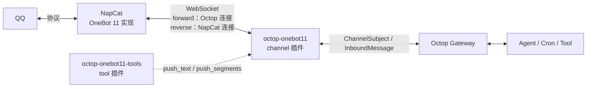

<div align="center">

# Octop OneBot 11

**把个人 QQ 接入 Octop 的 OneBot 11 / NapCat 通道插件**

正向 / 反向 WebSocket · 群聊触发门控 · 主动发送 · 断线排队补发

[](https://github.com/EchoAI-01/octop-onebot11/releases)
[](https://www.python.org/)
[](LICENSE)
[](https://github.com/TencentCloud/Octop)

[功能](#功能) · [环境要求](#环境要求) · [安装](#安装) · [配置](#配置) · [使用](#使用) · [常见问题](#常见问题) · [文档](#文档)

</div>

---

## 简介

Octop 官方的 QQ 通道只支持 QQ 开放平台机器人（AppID + Token），无法使用个人 QQ。本插件通过 Octop 的 `kind: channel` 扩展点接入 **OneBot 11** 协议，让 Octop 收发个人 QQ 消息，兼容 [NapCat](https://github.com/NapNeko/NapCatQQ) 及其他 OneBot 11 实现。

插件由两部分组成：

| 组件 | 类型 | 作用 |
|---|---|---|
| `octop-onebot11` | channel | 连接 NapCat，收发消息，处理触发策略、白名单、断线重连与排队补发 |
| `octop-onebot11-tools` | tool | 给 Agent 提供主动发送工具（群/私聊/合并转发） |

## 功能

- **正向与反向连接**：`forward` 由 Octop 连接 NapCat，`reverse` 由 NapCat 连接 Octop，适配内网、NAS 与 NAT 环境。
- **群聊触发门控**：默认只响应 `@` 或关键词，其余消息只进上下文缓存，不调用模型。
- **私聊策略**：`always` / `keyword` / `off` 三档。
- **主动发送**：向任意群或用户发消息，支持文本、图片、@ 成员、引用与合并转发，不要求已有会话。
- **断线排队补发**：主动消息在断线时进入持久化队列，重连后按序补发；也可配置 OneBot HTTP API 作为备用发送通道。
- **多账号（反向）**：一条反向通道可接入多个 QQ，按 `self_id` 路由收发。
- **访问控制**：群 / 私聊 / 发送人白名单与黑名单，出站目标白名单，可按 Agent 绑定通道。
- **事件处理**：好友请求、群邀请可自动通过；戳一戳可触发回复。
- **群巡检**：周期性汇总未触发的群消息并唤醒 Agent，带间隔与每小时上限。
- **安全默认**：反向监听非本机地址必须配置 token；握手阶段拒绝未授权连接；本地媒体只能读取授权目录。
- **弱依赖启动**：NapCat 离线或 QQ 未登录时通道照常注册，状态降级并自动重连，不阻塞 Octop 启动。

## 架构



- 一条 WebSocket 同时承载入站事件与出站 action，通过 `echo` 关联请求与响应。
- 每条连接只有一个读循环：action 响应与心跳就地处理，业务事件进入该连接的有序队列，由独立 worker 依次处理。
- 插件只依赖 Octop 自带的 `websockets`，不修改 Octop 核心或数据库。

## 环境要求

| 依赖 | 版本 | 说明 |
|---|---|---|
| Octop | 1.0.2 | 需支持 `kind: channel` 插件；验证组合：octop 1.0.2 / octop-gateway 1.0.3 / octop-harness 1.0.4 |
| Python | 3.12+ | 跟随 Octop 运行时，无需单独安装 |
| websockets | 13+ | Octop 内置，验证版本 15.0.1 |
| NapCat | 较新版本 | 或其他兼容 OneBot 11 的实现 |

## 安装

### 从源码安装

```bash
git clone https://github.com/EchoAI-01/octop-onebot11.git
cd octop-onebot11

octop plugin install ./plugins/octop-onebot11 --force
octop plugin install ./plugins/octop-onebot11-tools --force
```

### Docker 部署

```bash
# 宿主机：把插件目录放进 Octop 数据目录（路径按实际调整）
scp -r plugins/octop-onebot11 plugins/octop-onebot11-tools \
  user@host:/opt/octop/data/uploads/

# 容器内安装并重启
docker exec octop octop plugin install /data/.octop/uploads/octop-onebot11 --force
docker exec octop octop plugin install /data/.octop/uploads/octop-onebot11-tools --force
docker restart octop
```

`deploy/install.sh` 支持 Docker / Compose / systemd 三种形态，可远程执行；也可以直接按上面的命令手动安装。

> `octop plugin install` 只写磁盘。安装或升级后必须重启 Octop，运行中的 Gateway 才会加载新插件。

### 验证安装

```bash
octop plugin list
docker logs --tail 100 octop | grep -i "plugin channel kind"
```

看到 `applied 1 plugin channel kind(s): onebot11` 即加载成功；`plugin list` 在新进程里显示 `[not loaded]` 属正常现象。

## 配置

配置保存在通道的 `config_json` 中，可在 Octop Dashboard 的通道表单填写，也可以用 CLI 创建。每个通道独立配置，同一 Octop 可运行多个 QQ 通道。

### 正向：Octop 连接 NapCat

```bash
octop channel create --agent <agent_id> --kind onebot11 --name "QQ (NapCat)" \
  --config '{
    "connection_mode": "forward",
    "ws_url": "ws://127.0.0.1:3001",
    "token": "change-me",
    "group_reply_mode": "mention",
    "trigger_keywords": "小助手,日报,提醒"
  }'
```

### 反向：NapCat 连接 Octop

```bash
octop channel create --agent <agent_id> --kind onebot11 --name "QQ (NapCat 反向)" \
  --config '{
    "connection_mode": "reverse",
    "listen_host": "0.0.0.0",
    "listen_port": 3002,
    "listen_path": "/onebot/v11/ws",
    "token": "change-me"
  }'
```

创建后重启 Octop 让 Gateway 加载通道。

> **安全提示**
>
> - 反向模式监听非本机地址时必须设置 `token`，否则通道拒绝监听；仅当网络完全可信时才开启 `reverse_allow_no_token`。
> - 示例中的 `change-me` 只是占位。真实 token 不要写进命令行（会留在 shell 历史与进程列表），请用 Dashboard 密码框或环境变量方式注入。

### 常用字段

| 字段 | 类型 | 默认 | 说明 |
|---|---|---|---|
| `connection_mode` | select | `forward` | `forward` / `reverse` |
| `ws_url` | text | — | 正向必填，如 `ws://napcat:3001` |
| `token` | password | 空 | 正向发给 NapCat 校验；反向校验 NapCat 携带的 token |
| `listen_host` / `listen_port` / `listen_path` | text/number/text | `0.0.0.0` / `3002` / `/onebot/v11/ws` | 反向监听参数 |
| `self_id` | text | 空 | 机器人 QQ，留空自动获取 |
| `group_reply_mode` | select | `mention` | `mention` / `always` / `off` |
| `trigger_keywords` | text | 空 | 逗号分隔，命中后群聊无需 @ |
| `private_reply_mode` | select | `always` | `always` / `keyword` / `off` |
| `group_history_limit` | number | `10` | 回复时携带的群上下文条数 |
| `reply_with_quote` | switch | `false` | 回复是否引用原消息 |
| `allowed_groups` / `allowed_users` | text | 空 | 群 / 私聊白名单，逗号分隔 |
| `allowed_senders` / `blocked_senders` | text | 空 | 发送人白名单 / 黑名单（黑名单优先） |
| `outbox_enabled` | switch | `true` | 断线时主动消息进入队列，重连后补发 |
| `media_allowed_dirs` | text | 空 | 允许主动发送读取的本地媒体目录 |
| `multi_account` | switch | `false` | 反向模式允许接入多个 QQ |
| `monitor_enabled` | switch | `false` | 群巡检 |
| `poke_triggers_reply` | switch | `false` | 戳一戳触发回复 |
| `auto_accept_friend_request` / `auto_accept_group_invite` | switch | `false` | 自动通过好友请求 / 群邀请 |

### 高级字段

| 字段 | 默认 | 说明 |
|---|---|---|
| `reverse_allow_no_token` | `false` | 允许无 token 的反向监听（不安全） |
| `keyword_case_sensitive` | `false` | 关键词是否区分大小写 |
| `ignore_self_message` | `true` | 忽略机器人自己发出的消息 |
| `max_text_chars` | `1500` | 单条文本上限，超长自动分片 |
| `group_history_ttl_seconds` | `300` | 群上下文缓存有效期 |
| `send_rate_limit_count` / `send_rate_limit_window` | `20` / `60` | 发送限速（条数 / 秒），`0` 关闭 |
| `outbox_max_items` / `outbox_ttl_seconds` / `outbox_max_attempts` | `100` / `3600` / `3` | 队列容量、有效期、单条最大尝试次数 |
| `outbox_retry_min_seconds` / `outbox_retry_max_seconds` | `2` / `60` | 失败重试的指数退避区间 |
| `outbox_persist` / `outbox_persist_dir` | `true` / 空 | 队列落盘，默认 `~/.octop/onebot11/state` |
| `http_api_url` / `http_api_token` / `http_api_timeout_seconds` | 空 / 空 / `10` | OneBot HTTP API 备用发送通道 |
| `resolve_forward` | `false` | 入站合并转发是否展开为文本 |
| `monitor_interval_seconds` / `monitor_min_messages` / `monitor_max_per_hour` | `600` / `5` / `4` | 巡检周期、触发条数、每小时上限 |
| `monitor_keywords` / `monitor_min_trigger_gap_seconds` | 空 / `1800` | 巡检关键词过滤；同一群两次触发的最小间隔 |
| `connect_timeout_seconds` / `request_timeout_seconds` | `8` / `15` | 连接与 action 超时 |
| `startup_wait_seconds` | `2` | 创建通道时等待首次连接的时间 |
| `reconnect_min_seconds` / `reconnect_max_seconds` | `1` / `30` | 重连退避区间 |

## 使用

### 回复策略

| 场景 | 配置 | 模型调用 |
|---|---|---|
| 群聊仅 @ 或关键词 | `group_reply_mode=mention` + `trigger_keywords` | 命中时 1 轮 |
| 群聊全部回复 | `group_reply_mode=always` | 每条群消息 |
| 群聊不回复 | `group_reply_mode=off` | 0 |
| 私聊全部回复 | `private_reply_mode=always` | 每条私聊 |
| 私聊仅关键词 | `private_reply_mode=keyword` | 命中时 1 轮 |
| 私聊不回复 | `private_reply_mode=off` | 0 |
| 定时纯文本推送 | cron `task_type=text` | 0 |
| 定时生成内容 | cron `task_type=agent` | 每次 1 轮 |

非触发的群消息只进入短期上下文缓存（默认 10 条 / 300 秒），触发时作为上下文使用。

### 主动发送

Agent 通过工具插件发送，不需要该群此前有会话：

```python
onebot11_send_group(group_id="123456789", text="构建完成，产物已上传")

# 图片、@ 成员、引用
onebot11_send_group(
    group_id="123456789",
    text="新版本截图",
    image_url="https://example.com/build.png",
    at_user_id="10001",
)
onebot11_send_group(group_id="123456789", text="补充说明", reply_to_message_id="9001")

# 私聊
onebot11_send_private(user_id="10001", text="任务已结束")

# 合并转发
onebot11_send_forward_group(
    group_id="123456789",
    messages_json='[{"name": "早报", "text": "第一条"}, {"name": "早报", "text": "第二条"}]',
)
```

- 断线时：配置了 `http_api_url` 则改走 HTTP；否则进入待发队列，重连后补发。
- 返回值以 `发送失败:` 开头表示未成功，不会静默丢弃。
- 多通道部署时，请在 Agent 的工具配置里绑定 `channel_id`，否则工具无法确定用哪个通道。

### 定时任务

`task_type=text` 直接走通道发送，不启动 Agent：

```json
{
  "name": "每日群提醒",
  "trigger": "cron:0 9 * * *",
  "prompt": "早上好，今天的任务已排期。",
  "session_key": "<agent_id>:onebot11:group:123456789:group",
  "task_type": "text",
  "enabled": true
}
```

> 该群需要已有会话记录；群从未说过话时改用 `onebot11_send_group` 工具。

### NapCat 侧配置

完整步骤见 [docs/napcat.md](docs/napcat.md)，最小配置：

| 模式 | NapCat 侧 | 关键项 |
|---|---|---|
| 正向 | WebSocket 服务器 | 监听 `0.0.0.0:3001`，Token 与通道一致，消息格式 `array`，关闭上报自身消息 |
| 反向 | WebSocket 客户端 | URL `ws://octop:3002/onebot/v11/ws`，Token 与通道一致，消息格式 `array` |

## 常见问题

| 现象 | 原因 | 处理 |
|---|---|---|
| `等待 NapCat 反向连接` | NapCat 未配置 WS 客户端或网络不通 | 检查 NapCat 反向配置与 `listen_port` |
| `NapCat 未登录，等待登录` | QQ 未扫码 | 在 NapCat WebUI 登录，无需重建通道 |
| `反向模式未配置 token，已拒绝监听` | 非本机监听且无 token | 配置 `token`，或显式开启 `reverse_allow_no_token` |
| 群消息不触发 | 未 @ 且未命中关键词 | 检查 `group_reply_mode` 与 `trigger_keywords` |
| `发送失败: 存在 N 个 OneBot 11 通道` | 多通道且未绑定 | 在 Agent 工具配置中填写 `channel_id` |
| `发送失败: 本地文件路径发送未启用` | 未授权本地媒体目录 | 改用 http(s) 地址，或配置 `media_allowed_dirs` |
| 修改配置后不生效 | CLI 只写数据库 | 重启 Octop，或用 `scripts/patch_channel.py` 的 HTTP 模式 |
| `channel test` 返回 ok 但没连上 | 该命令只验证配置与生命周期 | 真实状态看 Dashboard 或日志 |

## 限制

- 投递语义是**至少一次**：发送超时可能重复，最多 `outbox_max_attempts` 条。
- 队列持久化为文件级，进程崩溃可能丢失最后一批未落盘消息。
- HTTP 备用通道仅覆盖出站；登录态与入站事件仍依赖 WebSocket。
- 多账号仅支持反向模式，主动发送到未连接的账号会直接报错。
- 群巡检每次触发都会消耗一轮模型调用，节流参数用于控制频次。

## 文档

| 文档 | 内容 |
|---|---|
| [docs/napcat.md](docs/napcat.md) | NapCat 部署与正反向配置 |
| [docs/design.md](docs/design.md) | 实现机制、消息映射、故障排查 |
| [docs/development.md](docs/development.md) | 开发环境、代码地图、开发约定 |
| [ROADMAP.md](ROADMAP.md) | 开发计划（独立文档） |

## License

[MIT](LICENSE)
