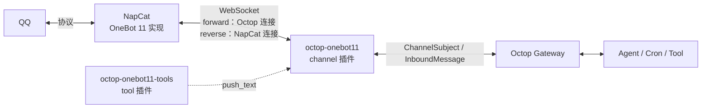

<div align="center">

# Octop OneBot 11

**把个人 QQ 接入 Octop 的 OneBot 11 / NapCat 通道插件**

正向 / 反向 WebSocket · 群聊触发门控 · 主动发送 · 断线排队补发 · 单文件、无额外依赖

[](https://github.com/EchoAI-01/octop-onebot11/releases)
[](https://www.python.org/)
[](LICENSE)
[](https://github.com/TencentCloud/Octop)

[功能](#功能) · [安装](#安装) · [配置](#配置) · [NapCat 配置](docs/napcat.md) · [设计](docs/design.md) · [开发文档](docs/development.md) · [常见问题](#常见问题)

</div>

---

Octop 官方的 QQ 通道依赖 QQ 开放平台机器人（AppID + Token），无法使用个人 QQ。本插件通过 Octop 的 `kind: channel` 扩展点接入 **OneBot 11** 协议，让 Octop 可以收发个人 QQ 消息，支持 [NapCat](https://github.com/NapNeko/NapCatQQ) 以及任何兼容 OneBot 11 的实现。

截至 2026-10，GitHub 上未检索到其他公开的 Octop OneBot 11 通道实现，因此本仓库同时承担“可用插件”和“接入参考”两个角色。

## 功能

- **两种传输方向**：`forward`（Octop 主动连 NapCat）与 `reverse`（NapCat 主动连 Octop），共用同一套协议与路由代码。
- **群聊触发门控**：默认只响应 `@` 或关键词，非触发消息只进群上下文缓存，不调用 LLM，避免“一直监听 = 一直烧 Token”。
- **私聊策略**：`always` / `keyword` / `off` 三档。
- **主动发送**：附带 `onebot11_send_group` / `onebot11_send_private` / `onebot11_send_forward_group` 工具，可向任意群/用户发消息（支持图片、@ 成员、引用、合并转发），不要求该会话已存在。
- **断线排队补发**：主动发送遇到 NapCat 断线时进入待发队列（outbox），重连后按序自动补发；失败按退避重试，过期/超限自动丢弃；**队列落盘持久化，Octop 重启后继续补发**。投递语义是“至少一次”：NapCat 已发出却没应答（超时）的消息最多按 `outbox_max_attempts` 重发，极端情况下可能重复，但不会无限重发。
- **多账号（反向）**：`multi_account` 开启后一条反向通道可同时接入多个 QQ，按 `self_id` 路由收发；工具用 `account` 参数指定发送账号。
- **HTTP 备用通道**：配置 `http_api_url` 后，WebSocket 断开期间出站 action 自动改走 OneBot HTTP API（覆盖主动发送、被动回复与 outbox 补发）。
- **事件处理**：好友请求 / 群邀请可配置自动通过；戳一戳可触发回复；撤回、入群等 notice 事件记日志。
- **发送人白名单 / 黑名单**：入站按发送者 QQ 号过滤（`allowed_senders` / `blocked_senders`），黑名单优先。
- **群巡检**：`monitor_enabled` 周期汇总未触发回复的群消息并唤醒 Agent 判断是否需要回应；间隔与每小时上限双重节流，Agent 回复「〔巡检跳过〕」即静默跳过。
- **出站白名单**：`allowed_groups` / `allowed_users` 限制可发送的群/用户，防止 Agent 误发；发送限速可配置。
- **定时任务零 Token**：配合 Octop cron 的 `task_type=text`，直接走通道发送，不启动 Agent。
- **富媒体发送**：图片、视频、语音、HTTP 文件，单文件上限 10 MB；服务器本地文件只能来自管理员授权的目录（`media_allowed_dirs`）。
- **安全默认**：反向监听绑定非本机地址时必须配置 token，否则拒绝监听；握手阶段就以 HTTP 401/404 拒绝陌生连接；Agent 工具可按 Agent 绑定到指定通道，多通道部署互不串用；群消息进入巡检摘要前会被中和并围栏，防止提示注入。
- **弱依赖启动**：NapCat 未启动、QQ 未登录时通道照常注册，状态降级并持续重连，不阻塞 Octop 启动。
- **单文件实现**：仅依赖 Octop 自带的 `websockets`，不需要改动 Octop 核心或数据库。

## 架构



- `forward`：NapCat 监听 `0.0.0.0:3001`，Octop 作为客户端接入。
- `reverse`：Octop 监听 `0.0.0.0:3002`（非本机地址必须配置 token），NapCat 作为客户端接入，适合 NapCat 位于 NAT 后或不允许入站的场景。
- 两种模式使用同一条 WebSocket 完成收事件与发 action，通过 `echo` 关联请求与响应。
- 每条连接只有一个读循环：action 响应与心跳就地处理，业务事件进入该连接的有序队列由独立 worker 依次处理——处理事件时再调 API（例如展开合并转发）不会卡住收包。

## 安装

### 前置条件

| 依赖 | 版本 | 说明 |
|---|---|---|
| Octop | 支持 `kind: channel` 插件的版本 | 验证版本：octop 1.0.2（octop-gateway 1.0.3 / octop-harness 1.0.4） |
| Python | 3.12+ | 跟随 Octop 运行时，无需单独安装 |
| websockets | 13+ | Octop 已内置，验证版本 15.0.1 |
| NapCat | 任意较新版本 | 或其他 OneBot 11 实现 |

### 从源码安装

```bash
git clone https://github.com/EchoAI-01/octop-onebot11.git
cd octop-onebot11

# 通道插件
octop plugin install ./plugins/octop-onebot11 --force

# 可选：主动发送工具（Agent 需要主动发消息时安装）
octop plugin install ./plugins/octop-onebot11-tools --force
```

### Docker 部署

Octop 容器内看到的路径与宿主机不同，先把插件目录放到数据目录，再在容器内安装：

```bash
# 宿主机：把插件复制到 Octop 数据目录（示例路径，按实际调整）
scp -r plugins/octop-onebot11 plugins/octop-onebot11-tools \
  user@host:/opt/octop/data/uploads/

# 容器内安装
docker exec octop octop plugin install /data/.octop/uploads/octop-onebot11 --force
docker exec octop octop plugin install /data/.octop/uploads/octop-onebot11-tools --force
docker restart octop
```

> `octop plugin install` 是离线操作：安装后需要重启 Octop，运行中的 Gateway 才会加载新插件。`octop plugin list` 在新进程里显示 `[not loaded]` 属正常现象，以启动日志中的 `applied N plugin channel kind(s)` 为准。

### 验证安装

```bash
octop plugin list
docker logs --tail 100 octop | grep -i "plugin channel kind"
```

## 配置

通道配置既可以在 Octop Dashboard 的表单里填写，也可以用 CLI 一次写入。所有字段都保存在该通道的 `config_json` 中，互不影响，因此同一个 Octop 可以同时运行多个 QQ 通道。

### 正向（Octop 连接 NapCat）

```bash
octop channel create --agent <agent_id> --kind onebot11 --name "QQ (NapCat)" \
  --config '{
    "connection_mode": "forward",
    "ws_url": "ws://127.0.0.1:3001",
    "token": "change-me",
    "group_reply_mode": "mention",
    "trigger_keywords": "小助手,日报,提醒"
  }'
```

### 反向（NapCat 连接 Octop）

```bash
octop channel create --agent <agent_id> --kind onebot11 --name "QQ (NapCat 反向)" \
  --config '{
    "connection_mode": "reverse",
    "listen_host": "0.0.0.0",
    "listen_port": 3002,
    "listen_path": "/onebot/v11/ws",
    "token": "change-me"
  }'
```

创建后执行 `octop restart`（或 `docker restart octop`）让 Gateway 加载通道。

> **安全提示**
>
> - 反向模式监听非本机地址（默认 `0.0.0.0`）时**必须设置 `token`**，否则通道拒绝监听（状态栏会给出原因）。确需无令牌运行（网络完全可信）才显式开启 `reverse_allow_no_token`。
> - 上面的 `"token": "change-me"` 只是示例。真实 token 不要写进命令行（会留在 shell 历史和进程列表里）：用 Dashboard 的密码输入框，或 `scripts/patch_channel.py --set-env token=环境变量名`。

### 表单字段

| 字段 | 类型 | 默认 | 说明 |
|---|---|---|---|
| `connection_mode` | select | `forward` | `forward` / `reverse` |
| `ws_url` | text | — | 正向必填，如 `ws://maim-bot-napcat:3001` |
| `token` | password | 空 | 正向：作为 `Authorization: Bearer` 发给 NapCat；反向：校验 NapCat 带来的 token（监听非本机地址时必填） |
| `listen_host` | text | `0.0.0.0` | 反向监听地址；非本机地址必须配置 `token` |
| `listen_port` | number | `3002` | 反向监听端口 |
| `listen_path` | text | `/onebot/v11/ws` | 反向监听路径，`/` 表示接受任意路径 |
| `reverse_allow_no_token` | switch | `false` | 允许无 token 的反向监听（不安全，仅网络完全可信时开启） |
| `self_id` | text | 空 | 机器人 QQ，留空自动从 `get_login_info` 获取 |
| `group_reply_mode` | select | `mention` | `mention`（@ 或关键词）/ `always` / `off` |
| `trigger_keywords` | text | 空 | 逗号分隔；命中后群聊无需 @ |
| `private_reply_mode` | select | `always` | `always` / `keyword` / `off` |
| `group_history_limit` | number | `10` | 触发时携带的群上下文条数 |
| `reply_with_quote` | switch | `false` | 回复时是否引用原消息 |
| `allowed_groups` | text | 空 | 群白名单，逗号分隔群号；留空不限制 |
| `allowed_users` | text | 空 | 私聊白名单，逗号分隔 QQ 号；留空不限制 |
| `outbox_enabled` | switch | `true` | 断线时主动消息进入待发队列，重连后补发 |
| `media_allowed_dirs` | text | 空 | 主动发送时允许读取的本地媒体目录（逗号分隔绝对路径，符号链接按真实路径判断）；留空则只能用 http(s) 地址 |
| `allowed_senders` | text | 空 | 发送人白名单（入站），逗号分隔 QQ 号；留空不限制 |
| `blocked_senders` | text | 空 | 发送人黑名单（入站），优先于白名单 |
| `poke_triggers_reply` | switch | `false` | 戳一戳机器人是否触发回复 |
| `auto_accept_friend_request` | switch | `false` | 自动通过好友请求 |
| `auto_accept_group_invite` | switch | `false` | 自动通过群邀请 |
| `monitor_enabled` | switch | `false` | 群巡检（周期汇总未触发消息并唤醒 Agent） |
| `multi_account` | switch | `false` | 反向模式允许多账号同时接入（按 self_id 路由） |

### 高级字段（仅 JSON / CLI）

| 字段 | 默认 | 说明 |
|---|---|---|
| `keyword_case_sensitive` | `false` | 关键词是否区分大小写 |
| `group_history_ttl_seconds` | `300` | 群上下文缓存有效期 |
| `ignore_self_message` | `true` | 忽略机器人自己发出的消息 |
| `max_text_chars` | `1500` | 单条文本上限，超长自动分片 |
| `connect_timeout_seconds` | `8` | 正向连接超时 |
| `request_timeout_seconds` | `15` | OneBot action 超时 |
| `startup_wait_seconds` | `2` | 创建通道时等待首次连接的时间 |
| `reconnect_min_seconds` / `reconnect_max_seconds` | `1` / `30` | 重连退避区间 |
| `send_rate_limit_count` / `send_rate_limit_window` | `20` / `60` | 发送限速（条数 / 秒）；count=0 关闭限速 |
| `outbox_max_items` | `100` | 待发队列容量上限，超出后新的主动消息直接失败 |
| `outbox_ttl_seconds` | `3600` | 待发消息有效期，过期丢弃 |
| `outbox_max_attempts` | `3` | 单条消息最多尝试发送的次数；无应答（超时）的那次同样计入，避免对慢 NapCat 无限重发 |
| `outbox_retry_min_seconds` / `outbox_retry_max_seconds` | `2` / `60` | 失败重试退避区间（指数） |
| `outbox_persist` | `true` | 队列落盘（`outbox_persist_dir`，默认 `~/.octop/onebot11/state`），重启后继续补发 |
| `outbox_persist_dir` | 空 | 持久化目录；空用默认 `~/.octop/onebot11/state` |
| `http_api_url` | 空 | OneBot HTTP API 地址（如 `http://127.0.0.1:3000`）；WS 断开时出站走此通道 |
| `http_api_token` | 空 | HTTP API Token；留空复用 `token` |
| `http_api_timeout_seconds` | `10` | HTTP action 超时 |
| `resolve_forward` | `false` | 入站合并转发是否调用 `get_forward_msg` 展开为文本 |
| `monitor_interval_seconds` | `600` | 巡检周期（秒，最小 30） |
| `monitor_min_messages` | `5` | 触发巡检所需的最少未响应消息数 |
| `monitor_keywords` | 空 | 巡检关键词过滤，逗号分隔；留空不过滤 |
| `monitor_min_trigger_gap_seconds` | `1800` | 同一群两次巡检触发的最小间隔 |
| `monitor_max_per_hour` | `4` | 全局每小时巡检触发上限 |

Dashboard 表单写入的数字、布尔值常常是字符串（`"3002"`、`"true"`），插件会统一转换；无法解析的值回退到默认并写一条警告日志，不会让通道起不来。

## 触发与 Token 控制

常驻监听本身不消耗 Token：WebSocket 只负责收消息，是否进入 Agent 由触发门控决定。这一设计参考了 MaiBot 的 `MessageTurnScheduler`。

| 场景 | 配置 | LLM 调用 |
|---|---|---|
| 群聊仅 @ 或关键词 | `group_reply_mode="mention"` + `trigger_keywords` | 仅命中时 1 轮 |
| 群聊回复全部 | `group_reply_mode="always"` | 每条群消息 |
| 群聊不回复 | `group_reply_mode="off"` | 0 |
| 私聊全部回复 | `private_reply_mode="always"` | 每条私聊 |
| 私聊仅关键词 | `private_reply_mode="keyword"` | 仅命中时 |
| 私聊不回复 | `private_reply_mode="off"` | 0 |
| 定时纯文本推送 | cron `task_type="text"` | 0 |
| 定时生成内容 | cron `task_type="agent"` | 每次 1 轮 |

非触发的群消息会进入短期上下文缓存（默认 10 条 / 300 秒），触发时作为上下文使用，不调用模型；缓存条目带有发送者 QQ 号。

`group_reply_mode="always"` 时插件会向 Octop 核心声明群消息全可见（`group_context.visibility="all"`）：核心只在该声明下才允许 `activation=always`，否则会静默降级为 `mention`。

关键词采用子串匹配，建议使用“日报 / 提醒 / 小助手”这类低误触词，不要用“在吗 / 你好”。

## 主动发送

Octop 核心没有“向任意群发消息”的 REST 接口，因此本仓库附带一个 `tool` 插件，让 Agent 可以直接指定群号发送：

```python
onebot11_send_group(group_id="123456789", text="构建完成，产物已上传")
onebot11_send_private(user_id="10001", text="任务已结束")
# 富媒体与 @：image_url 支持 http(s) URL；服务器本地文件路径只有在通道配置了 media_allowed_dirs 且文件位于其中时才可用（自动转 base64，上限 10 MB）
onebot11_send_group(group_id="123456789", text="新版本截图", image_url="https://example.com/build.png", at_user_id="10001")
# 引用回复某条消息
onebot11_send_group(group_id="123456789", text="针对这条的补充", reply_to_message_id="9001")
# 合并转发：多条文本打包成一条转发卡片
onebot11_send_forward_group(group_id="123456789", messages_json='[{"name": "早报", "text": "第一条"}, {"name": "早报", "text": "第二条"}]')
```

- 不要求该群此前与机器人有过会话。
- 发送失败会返回 `发送失败: ...`，不会静默丢弃。
- NapCat 断线时：配置了 `http_api_url` 则自动改走 HTTP 发送；否则消息进入待发队列（`outbox_enabled`），重连后自动补发，返回值会注明排队状态；队列关闭或已满时仍返回 `发送失败`。
- 目标群/用户不在 `allowed_groups` / `allowed_users` 白名单内时，主动发送返回 `发送失败`，被动回复静默丢弃并记日志。
- `group_id` / `user_id` 必须是纯数字 QQ 号。
- **通道选择与隔离**：每个工具在 Agent 的工具配置里都有一个 `channel_id` 设置。绑定后该 Agent 只能经此通道发送，模型传入的 `channel_id` 参数无法改道（与绑定不一致会被拒绝）；未绑定时，只有恰好一个 OneBot 通道在运行才会自动选用，存在多个通道则拒绝并提示先绑定。多 Agent / 多通道部署请务必绑定。

定时任务同理，`task_type="text"` 不启动 Agent：

```json
{
  "name": "每日群提醒",
  "trigger": "cron:0 9 * * *",
  "prompt": "早上好，今天的任务已排期。",
  "session_key": "<agent_id>:onebot11:group:123456789:group",
  "task_type": "text",
  "enabled": true
}
```

> `text` 模式要求该群已有会话记录（即此前收到过群消息），否则无法定位 `channel_id`。群从未说过话时，改用 `onebot11_send_group` 工具。

## NapCat 配置

完整步骤见 [docs/napcat.md](docs/napcat.md)，这里是最小配置。

> 3001 / 3002 端口只应在容器网络或内网可达，不要映射到公网；token 使用强随机值。NapCat WebUI 端口（6099）同理，建议只绑 `127.0.0.1` 或放在反向代理与访问控制之后，详见 [docs/napcat.md](docs/napcat.md)。

**正向**：NapCat WebUI → 网络配置 → 新建 WebSocket 服务器

| 项 | 值 |
|---|---|
| 监听 | `0.0.0.0:3001` |
| Token | 与通道 `token` 一致 |
| 消息格式 | `array` |
| 上报自身消息 | 关闭 |

**反向**：NapCat WebUI → 网络配置 → 新建 WebSocket 客户端

| 项 | 值 |
|---|---|
| URL | `ws://octop:3002/onebot/v11/ws` |
| Token | 与通道 `token` 一致 |
| 消息格式 | `array` |
| 重连间隔 | 3000 ms |

## 消息与事件映射

| OneBot 11 | Octop |
|---|---|
| `message_type=group` | `ChannelSubject(subject_id="group:<gid>", chat_type="group")` |
| `message_type=private` | `ChannelSubject(subject_id="user:<uid>", chat_type="dm")` |
| `text` | `TextContent` |
| `at` 且 `qq == self_id` | `metadata.bot_mentioned=true` |
| 关键词命中 | `metadata.keyword_triggered=true`，按“被提及”处理 |
| `image` / `video` / `record` | `ImageContent` / `VideoContent` / `AudioContent` |
| `file` | `FileContent`（仅 HTTP URL 直接发送） |
| 回复 | `metadata.reply_to`，`reply_with_quote` 打开时附带 `reply` 段 |

出站：

| Octop | OneBot action |
|---|---|
| 群消息 | `send_group_msg` |
| 私聊消息 | `send_private_msg` |
| 文本 | `{"type":"text","data":{"text":"..."}}` |
| 媒体 | `image` / `video` / `record`，`file=base64://...` |

## 测试

```bash
pip install "websockets==15.0.1"

# 纯逻辑单元测试：解析、路由、配置、鉴权（不需要 Octop）
python tools/test_plugin_offline.py

# 回归测试：每个审计发现对应一条用例（进程内假 NapCat + 真实 websockets）
python tools/test_plugin_regression.py

# 真实 WebSocket 端到端：mock NapCat 子进程
python tools/test_plugin_e2e.py

# 真实 Octop 核心契约测试：加载真实插件加载器 / ChannelManager / GroupContextManager / RateLimiter
pip install "octop-gateway==1.0.3" "octop-harness==1.0.4"
python tools/test_plugin_core_integration.py     # 未安装 Octop 时自动跳过
```

- 端到端覆盖：登录识别、群 @ 入站、被动群回复、主动群/私聊发送、未登录降级、断线排队补发、HTTP 回退、NapCat 收到却不应答时不会无限重发、反向模式（含多账号）。
- 回归测试覆盖：收包循环不被 API 调用阻塞、反向监听的安全默认与握手拒绝、重试预算与限速、本地媒体白名单、outbox 落盘权限与校验、HTTP 响应上限、巡检提示注入中和、戳一戳与自动通过遵守发送人策略、去重与 CQ 转义、工具按 Agent 绑定通道等。
- 核心契约测试用真实 Octop 组件复核插件的接入面（配置构建、群上下文激活、限速槽、工具配置透传），CI 里作为独立任务运行，见 [.github/workflows/ci.yml](.github/workflows/ci.yml)。

## 常见问题

| 现象 | 原因 | 处理 |
|---|---|---|
| `runtime_error = 等待 NapCat 反向连接` | NapCat 未配置 WebSocket 客户端，或网络不通 | 检查 NapCat 反向 WS 配置与 `listen_port` |
| `runtime_error = 连接已断开，等待 NapCat 重连` | NapCat 重启 / 网络抖动 | 正常现象，会自动重连 |
| `runtime_error = NapCat 未登录，等待登录` | QQ 未扫码登录 | 在 NapCat WebUI 扫码，通道无需重建 |
| `runtime_error = 反向 WS 端口监听失败` | 端口被占用 | 换 `listen_port`，或停掉占用进程 |
| `runtime_error = 反向模式未配置 token，已拒绝监听 …` | 反向监听在非本机地址上且没有 token | 配置 `token`；网络完全可信时才开启 `reverse_allow_no_token` |
| 群消息不触发 | 未 @ 且未命中关键词 | 检查 `group_reply_mode` 与 `trigger_keywords` |
| `发送失败: 存在 N 个 OneBot 11 通道，无法自动选择` | 多个通道且该 Agent 没有绑定 | 在 Agent 的工具配置里填写 `channel_id` |
| `发送失败: 本地文件路径发送未启用` | 用了服务器本地图片路径，但没有授权目录 | 改用 http(s) 图片，或配置 `media_allowed_dirs` |
| 主动发送返回“未连接” | 通道 `is_connected=false` | 先确认 NapCat 已登录、WebSocket 已连上 |
| `channel test` 返回 ok 但实际没连上 | 该命令只验证配置可实例化与生命周期 | 真实状态看 Dashboard 或日志 |
| 修改配置后不生效 | CLI 只写数据库 | 执行 `octop restart` 或 `docker restart octop` |

更多排查方法见 [docs/design.md#故障排查](docs/design.md)。

## 限制

- 投递语义是**至少一次**：发送超时（NapCat 可能已发出）会占用一次重试额度并在退避后重发，QQ 侧最多出现 `outbox_max_attempts` 条相同消息；想降低重复，可调小该值（`1` 表示无应答的消息不再重发，但连接在发出后、应答前断开的情形仍可能重发一次）。
- 待发队列持久化为**文件级**（enqueue/flush/stop 时落盘）：覆盖 NapCat 重启、网络抖动与 Octop 正常重启；进程崩溃可能丢失最后一批未落盘消息。去重缓存仍在内存（真实 NapCat 断线不会重推消息）。
- HTTP 备用通道仅覆盖**出站**：登录态探测、入站事件仍依赖 WebSocket。
- 多账号仅支持**反向模式**：每个账号一条连接，按 `self_id` 路由；主动发送指定未连接的 `account` 会直接报错（不排队）。
- 群巡检每次触发都会唤醒一轮 Agent（消耗 Token）：节流参数就是为控制频次设计的；Agent 无需介入时回复「〔巡检跳过〕」会被通道静默吞掉，不会发到群里。
- 没有投递回执：只保证 OneBot `retcode=0`，不返回 `message_id`，无法感知 QQ 侧吞消息。

## 目录结构

```
octop-onebot11/
├─ plugins/
│  ├─ octop-onebot11/          # channel 插件（主插件）
│  │  ├─ plugin.yaml
│  │  └─ main.py
│  └─ octop-onebot11-tools/    # tool 插件（主动发送）
│     ├─ plugin.yaml
│     └─ main.py
├─ tools/                      # mock NapCat 与测试脚本
├─ scripts/                    # patch_channel.py：配置读-合并-写（防 patch 整体替换丢配置）
├─ deploy/                     # install.sh 跨形态部署脚本、Windows 脚本、NapCat 模板
├─ docs/                       # 开发手记、设计说明、NapCat 配置
└─ .github/workflows/ci.yml
```

## 兼容性

- 在 octop 1.0.2（octop-gateway 1.0.3 / octop-harness 1.0.4）+ websockets 15.0.1 + NapCat 上验证；CI 的 `core-integration` 任务固定这两个版本，升级 Octop 时先在那里回归。
- 使用 `websockets.asyncio.server` 时要求 websockets ≥ 13；更低版本自动回退到 `websockets.serve`。
- 依赖 Octop 的 `PluginContext.channel()` 扩展点。Octop 升级后若该接口变动，需要同步回归 `setup()` 与 `BaseChannel` 契约。

## 参与开发

开发环境搭建、代码地图、开发约定、常见任务与路线图见 [docs/development.md](docs/development.md)。

部署：`deploy/install.sh` 支持 systemd 裸机与 Docker 两种形态（自动探测，`--host` 远程执行，详见脚本头部注释；热重载 token 建议用环境变量 `OCTOP_RELOAD_TOKEN`，命令行参数在进程列表里可见）；配置修改用 `scripts/patch_channel.py`（`octop channel patch` 是整体替换，该脚本做读-合并-写并保护被掩码的 token；提供 `--api-url/--api-token` 时走核心 HTTP PATCH，**配置热生效免重启**）。

当前优先事项：

1. 配置热更新接口 R1 Phase 2/3（核心 `/config` GET/PATCH 增量接口，详见开发文档第 9 节；本仓库侧 Phase 1 脚本与热生效写入路径均已落地，剩余部分需向 Octop 核心提 PR）
2. 指标与健康检查（可观测性）
3. 配置向导 / 表单联动（依赖 Dashboard 能力）

## License

[MIT](LICENSE)
